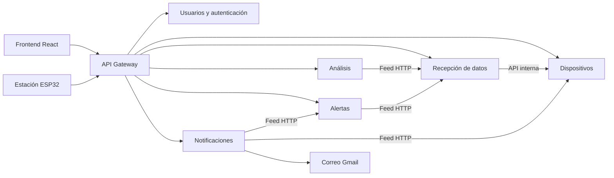

# Silvana

Sistema de monitoreo ambiental IoT desarrollado con React, Three.js y seis microservicios Node.js. Recibe mediciones de una estación ESP32, muestra sus lecturas, calcula estadísticas y genera alertas y notificaciones.

El proyecto se organiza en un monorepositorio: cada microservicio conserva su código, API, configuración, migraciones y base de datos independiente. El frontend y la estación acceden al backend mediante el API Gateway.

## Arquitectura



Los servicios se comunican mediante HTTP; no consultan directamente las bases de los demás. Los feeds internos requieren un token compartido y no se publican a través del Gateway.

| Componente | Carpeta | Puerto local | Función |
| --- | --- | ---: | --- |
| Frontend | `frontend` | 5173 | Acceso, dashboard, paisaje 3D y paneles |
| API Gateway | `api-gateway` | 8000 | Entrada y encaminamiento de solicitudes |
| Autenticación | `usuarios-auth-service` | 8001 | Registro, inicio y cierre de sesión, acceso protegido |
| Dispositivos | `dispositivos-service` | 8002 | Propiedad, vinculación ESP32, credenciales y presencia |
| Recepción | `recepcion-iot-service` | 8003 | Validación, almacenamiento e historial de lecturas |
| Análisis | `analisis-service` | 8004 | Promedios, mínimos, máximos y series horarias |
| Alertas | `alertas-service` | 8005 | Reglas por estación, incidencias y reconocimiento |
| Notificaciones | `notificaciones-service` | 8006 | Centro web, preferencias y cola de correo |

Cada uno de los seis microservicios dispone de su propia conexión PostgreSQL. Se usa Supabase como alojamiento de las bases; SQLite se admite para pruebas y desarrollo local.

## Ejecutar en desarrollo

Requisitos: Git, Node.js **22.16 o superior** y npm. Arduino IDE es necesario únicamente para compilar y cargar el firmware de la estación.

```sh
git clone https://github.com/jhonatan2405/silvana.git
cd silvana
npm ci
```

1. Copia `.env.example` como `.env` dentro de cada carpeta del backend.
2. Configura una conexión `DATABASE_URL` independiente por microservicio. Para Supabase usa PostgreSQL con TLS; los certificados públicos están incluidos en las carpetas `certs/`.
3. Usa el mismo `INTERNAL_SERVICE_TOKEN` privado en dispositivos, recepción, análisis, alertas y notificaciones. Mantén los puertos y URLs locales de los ejemplos.
4. Conserva `FRONTEND_ORIGIN=http://localhost:5173` para esta configuración local.
5. Inicia el conjunto:

```sh
npm run dev
```

Abre [http://localhost:5173](http://localhost:5173). Este comando inicia los ocho procesos. Cada carpeta admite también `npm run dev` para ejecutarla por separado. En Windows, los iniciadores `infra/start-*.cmd` permiten abrirlos en ventanas CMD individuales. No inicies dos copias sobre los mismos puertos.

Las tablas se preparan al iniciar cada servicio. Los scripts SQL y los comandos de migración permanecen dentro de su carpeta; consulta su README antes de importar datos existentes. Los archivos `.env`, bases locales y credenciales de hardware no se incluyen en el repositorio.

## Estación y notificaciones

El firmware está en `recepcion-iot-service/firmware/silvana_station/`. Copia `config.example.h` como `config.h` y sigue la [guía de conexión](docs/conexion-esp32.md). El firmware utiliza HTTP hacia el Gateway, sin credenciales de base de datos en el ESP32.

- La estación se considera sin comunicación después de **60 segundos** sin contacto válido. La comprobación y el procesamiento añaden unos segundos; el correo depende además de la entrega del proveedor.
- Una regla genera una incidencia al comenzar el incumplimiento. Las lecturas consecutivas no la duplican. Puede generar otra después de recuperarse y volver a incumplir.
- Los avisos de conexión, recuperación y habilitación de estaciones se configuran independientemente de las alertas de umbral.
- El centro web funciona sin configurar Gmail. El correo se activa por cuenta en Notificaciones → Preferencias después de configurar el remitente.
- La placa resistiva detecta presencia de agua; no mide precipitación en milímetros.

Para Gmail completa las variables SMTP de `notificaciones-service/.env` con la cuenta remitente y su contraseña de aplicación. El destinatario se obtiene de la cuenta autenticada. La [documentación de notificaciones](notificaciones-service/README.md) explica preferencias, entrega, reintentos y plantilla con logo.

## Comprobaciones

```sh
npm test
npm run build
```

Las últimas comprobaciones incluyen **34 pruebas** de integración, validación, aislamiento entre usuarios, persistencia, deduplicación, alertas, notificaciones y protocolo USB. No requieren credenciales PostgreSQL reales ni envían correo externo.

Los comandos `verify:gateway` presentes en algunos servicios verifican bases o procesos configurados y crean datos temporales; revisa su README antes de ejecutarlos. No son necesarios para ejecutar la suite aislada anterior.

## Docker y despliegue

Cada componente tiene un `Dockerfile`. `infra/compose.yaml` describe la ejecución en contenedores con bases externas o volúmenes locales de desarrollo. Se debe proporcionar la configuración privada fuera del código. Los contenedores no se han validado con Docker en esta máquina.

El despliegue público está pendiente. La propuesta es frontend en Vercel y backend en Render, validando recursos y límites gratuitos antes de publicarlo. Los archivos actuales no afirman que exista un despliegue agregado listo para Render. Render Free bloquea SMTP, por lo que el envío de correo allí requiere adaptar el transporte a una API HTTPS.

## Documentación

- [Análisis y alertas](docs/analisis-alertas.md)
- [Notificaciones y correo](notificaciones-service/README.md)
- [Conexión ESP32](docs/conexion-esp32.md)
- [Infraestructura y ejecución](infra/README.md)
- [Documentación del proyecto](docs/README.md)

Algunos documentos describen etapas anteriores; el estado actual de los seis servicios se resume en este README y en el README de cada carpeta. Los respaldos históricos y las herramientas locales de revisión no forman parte de esta entrega.

## Integrantes

- [jhonatan2405](https://github.com/jhonatan2405)
- [juanxpz1](https://github.com/juanxpz1)
